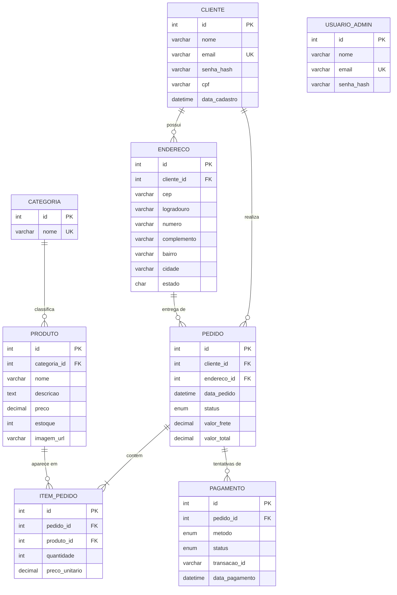

# Banco de dados — Multiverso Colecionáveis

SGBD: **MySQL 8**. Scripts: [`create.sql`](../create.sql) (estrutura) e [`insert.sql`](../insert.sql) (dados de teste).
Banco: `multiverso_colecionaveis`, 8 tabelas.

## 1. Modelo conceitual

| Entidade | O que representa |
|---|---|
| Cliente | Quem compra na loja |
| Endereço | Local de entrega; um cliente pode ter vários |
| Categoria | Agrupamento do catálogo (Animes/Mangás, Super-heróis, Cultura Pop) |
| Produto | Item à venda, de uma única categoria |
| Pedido | Uma compra fechada por um cliente, entregue em um endereço |
| Item do pedido | Cada produto dentro de um pedido, com quantidade e o preço da hora da compra |
| Pagamento | Tentativa de pagamento de um pedido |
| Usuário administrador | Quem gerencia produtos e pedidos; login separado do cliente |

### Relacionamentos

| Relação | Cardinalidade | Observação |
|---|---|---|
| Categoria → Produto | 1 : N | Todo produto pertence a uma categoria |
| Cliente → Endereço | 1 : N | |
| Cliente → Pedido | 1 : N | |
| Endereço → Pedido | 1 : N | O pedido guarda o endereço de entrega usado |
| Pedido → Item do pedido | 1 : N (mínimo 1) | Um pedido tem ao menos um item |
| Produto → Item do pedido | 1 : N | Resolve a relação N:N entre pedido e produto |
| Pedido → Pagamento | 1 : N | Cada vez que o link de pagamento é gerado, nasce uma tentativa |

`usuario_admin` não se relaciona com as outras tabelas: é uma credencial à parte.

## 2. Diagrama entidade-relacionamento (modelo lógico)

## 3. Dicionário de dados (modelo físico)

Legenda: **PK** chave primária · **FK** chave estrangeira · **UK** valor único · **NN** obrigatório.

### cliente

| Campo | Tipo | Chave | Obrigatório | Descrição |
|---|---|---|---|---|
| id | INT, auto incremento | PK | sim | Identificador |
| nome | VARCHAR(120) | | NN | Nome completo |
| email | VARCHAR(150) | UK | NN | Login do cliente |
| senha_hash | VARCHAR(255) | | NN | Senha com hash bcrypt; nunca em texto puro |
| cpf | VARCHAR(14) | | não | Opcional |
| data_cadastro | DATETIME | | NN | Padrão: data e hora atual |

### endereco

| Campo | Tipo | Chave | Obrigatório | Descrição |
|---|---|---|---|---|
| id | INT, auto incremento | PK | sim | |
| cliente_id | INT | FK → cliente.id | NN | Dono do endereço |
| cep | VARCHAR(9) | | NN | Preenchido com apoio do ViaCEP |
| logradouro | VARCHAR(150) | | NN | Rua |
| numero | VARCHAR(10) | | NN | |
| complemento | VARCHAR(60) | | não | |
| bairro | VARCHAR(100) | | NN | |
| cidade | VARCHAR(100) | | NN | |
| estado | CHAR(2) | | NN | UF |

### categoria

| Campo | Tipo | Chave | Obrigatório | Descrição |
|---|---|---|---|---|
| id | INT, auto incremento | PK | sim | |
| nome | VARCHAR(60) | UK | NN | Nome da categoria |

### produto

| Campo | Tipo | Chave | Obrigatório | Descrição |
|---|---|---|---|---|
| id | INT, auto incremento | PK | sim | |
| categoria_id | INT | FK → categoria.id | NN | |
| nome | VARCHAR(150) | | NN | |
| descricao | TEXT | | não | |
| preco | DECIMAL(10,2) | | NN | Valor monetário em decimal, nunca float |
| estoque | INT | | NN | Padrão 0; diminui a cada pedido |
| imagem_url | VARCHAR(255) | | não | Caminho da foto, por exemplo `/produtos/goku.jpg` |

### pedido

| Campo | Tipo | Chave | Obrigatório | Descrição |
|---|---|---|---|---|
| id | INT, auto incremento | PK | sim | Número do pedido |
| cliente_id | INT | FK → cliente.id | NN | |
| endereco_id | INT | FK → endereco.id | NN | Endereço de entrega |
| data_pedido | DATETIME | | NN | Padrão: data e hora atual |
| status | ENUM | | NN | `aguardando_pagamento` (padrão), `pago`, `enviado`, `entregue`, `cancelado` |
| valor_frete | DECIMAL(10,2) | | NN | Definido pelo servidor |
| valor_total | DECIMAL(10,2) | | NN | Itens + frete, calculado pelo servidor |

### item_pedido

| Campo | Tipo | Chave | Obrigatório | Descrição |
|---|---|---|---|---|
| id | INT, auto incremento | PK | sim | |
| pedido_id | INT | FK → pedido.id | NN | |
| produto_id | INT | FK → produto.id | NN | |
| quantidade | INT | | NN | |
| preco_unitario | DECIMAL(10,2) | | NN | Preço do produto no momento da compra |

### pagamento

| Campo | Tipo | Chave | Obrigatório | Descrição |
|---|---|---|---|---|
| id | INT, auto incremento | PK | sim | |
| pedido_id | INT | FK → pedido.id | NN | Não é único: cada link gerado cria uma tentativa |
| metodo | ENUM | | não | `pix`, `cartao` ou `boleto`; fica vazio até o Mercado Pago informar a forma usada |
| status | ENUM | | NN | `pendente` (padrão), `aprovado` ou `recusado` |
| transacao_id | VARCHAR(100) | | não | Identificador do pagamento no Mercado Pago |
| data_pagamento | DATETIME | | não | Preenchida quando o status é atualizado pelo webhook |

### usuario_admin

| Campo | Tipo | Chave | Obrigatório | Descrição |
|---|---|---|---|---|
| id | INT, auto incremento | PK | sim | |
| nome | VARCHAR(120) | | NN | |
| email | VARCHAR(150) | UK | NN | Login do administrador |
| senha_hash | VARCHAR(255) | | NN | Hash bcrypt |

## 4. Decisões de modelagem

- **Preço em `DECIMAL(10,2)`:** float acumula erro de arredondamento em dinheiro. O driver `mysql2` devolve DECIMAL como texto (`"249.90"`), então o front converte com `Number()` antes de calcular.
- **`preco_unitario` em `item_pedido`:** guarda o preço da hora da compra. Mudar o preço do produto depois não altera pedidos antigos.
- **Transação no pedido:** pedido, itens e baixa de estoque são gravados juntos. Se qualquer passo falha (por exemplo, estoque insuficiente), tudo é desfeito (`ROLLBACK`).
- **Baixa de estoque protegida:** o `UPDATE` só acontece se `estoque >= quantidade`, o que evita estoque negativo mesmo com dois pedidos quase simultâneos.
- **Senhas com hash bcrypt:** tanto de clientes quanto do administrador.
- **Tabela `usuario_admin` separada de `cliente`:** os dois tipos de login têm permissões diferentes, e um token de cliente nunca vale como token de administrador.
- **Integridade referencial:** todas as chaves estrangeiras são declaradas. Por isso um produto que já aparece em algum pedido não pode ser excluído.
