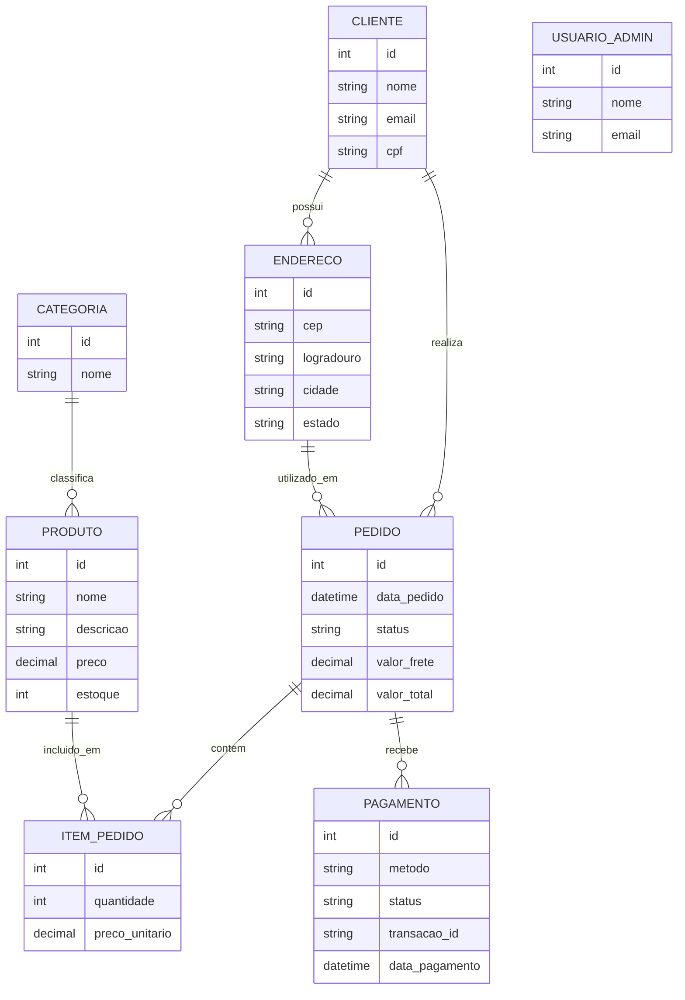

# Modelos de dados — Multiverso Colecionáveis

Este documento apresenta os modelos conceitual e lógico da loja, com base no esquema implementado em [`create.sql`](../create.sql). O modelo físico é o próprio script SQL executado em MySQL/MariaDB.

## Modelo conceitual

O modelo conceitual descreve as entidades do negócio e suas relações, sem depender dos tipos específicos do MySQL.

`ITEM_PEDIDO` representa a associação entre pedido e produto e guarda quantidade e preço unitário praticado na compra. `USUARIO_ADMIN` possui autenticação própria e não se relaciona por chave estrangeira com `CLIENTE`.

## Modelo lógico

Convenções: **PK** = chave primária; **FK** = chave estrangeira; **UQ** = valor único; **NN** = obrigatório. `NULL` indica campo opcional.

| Tabela | Atributos |
| --- | --- |
| `cliente` | `id INT` PK, auto incremento; `nome VARCHAR(120)` NN; `email VARCHAR(150)` NN, UQ; `senha_hash VARCHAR(255)` NN; `cpf VARCHAR(14)` NULL; `data_cadastro DATETIME` NN, padrão `CURRENT_TIMESTAMP` |
| `endereco` | `id INT` PK, auto incremento; `cliente_id INT` NN, FK → `cliente.id`; `cep VARCHAR(9)` NN; `logradouro VARCHAR(150)` NN; `numero VARCHAR(10)` NN; `complemento VARCHAR(60)` NULL; `bairro VARCHAR(100)` NN; `cidade VARCHAR(100)` NN; `estado CHAR(2)` NN |
| `categoria` | `id INT` PK, auto incremento; `nome VARCHAR(60)` NN, UQ |
| `produto` | `id INT` PK, auto incremento; `categoria_id INT` NN, FK → `categoria.id`; `nome VARCHAR(150)` NN; `descricao TEXT` NULL; `preco DECIMAL(10,2)` NN; `estoque INT` NN, padrão `0`; `imagem_url VARCHAR(255)` NULL |
| `usuario_admin` | `id INT` PK, auto incremento; `nome VARCHAR(120)` NN; `email VARCHAR(150)` NN, UQ; `senha_hash VARCHAR(255)` NN |
| `pedido` | `id INT` PK, auto incremento; `cliente_id INT` NN, FK → `cliente.id`; `endereco_id INT` NN, FK → `endereco.id`; `data_pedido DATETIME` NN, padrão `CURRENT_TIMESTAMP`; `status ENUM('aguardando_pagamento','pago','enviado','entregue','cancelado')` NN, padrão `aguardando_pagamento`; `valor_frete DECIMAL(10,2)` NN; `valor_total DECIMAL(10,2)` NN |
| `item_pedido` | `id INT` PK, auto incremento; `pedido_id INT` NN, FK → `pedido.id`; `produto_id INT` NN, FK → `produto.id`; `quantidade INT` NN; `preco_unitario DECIMAL(10,2)` NN |
| `pagamento` | `id INT` PK, auto incremento; `pedido_id INT` NN, FK → `pedido.id`; `metodo ENUM('pix','cartao','boleto')` NN; `status ENUM('aprovado','pendente','recusado')` NN, padrão `pendente`; `transacao_id VARCHAR(100)` NULL; `data_pagamento DATETIME` NULL |

### Relacionamentos e restrições

- Um cliente pode cadastrar vários endereços e realizar vários pedidos; cada endereço pertence a um cliente e cada pedido referencia um cliente e um endereço.
- Uma categoria pode classificar vários produtos; cada produto referencia uma categoria.
- Pedido e produto formam uma relação muitos-para-muitos resolvida por `item_pedido`.
- Cada pagamento referencia um pedido. Embora o comentário de `create.sql` descreva “1 pedido : 1 pagamento”, a tabela não declara `UNIQUE(pedido_id)`. Portanto, o banco atual permite mais de um pagamento para o mesmo pedido. A cardinalidade implementada é um pedido para zero ou muitos pagamentos.
- O banco não declara unicidade para CPF, para o par (`pedido_id`, `produto_id`) em `item_pedido`, nem restrições `CHECK` para preço, quantidade ou estoque.
- As chaves estrangeiras não especificam `ON DELETE`; aplicam o comportamento padrão do MySQL/MariaDB.

## Resumo para apresentação

> O banco relacional da loja organiza clientes, endereços, catálogo, pedidos, itens e pagamentos. As chaves estrangeiras preservam as relações entre esses dados. A tabela de itens resolve o relacionamento muitos-para-muitos entre pedidos e produtos e registra o preço histórico de cada item. O acesso administrativo fica em uma tabela separada.
